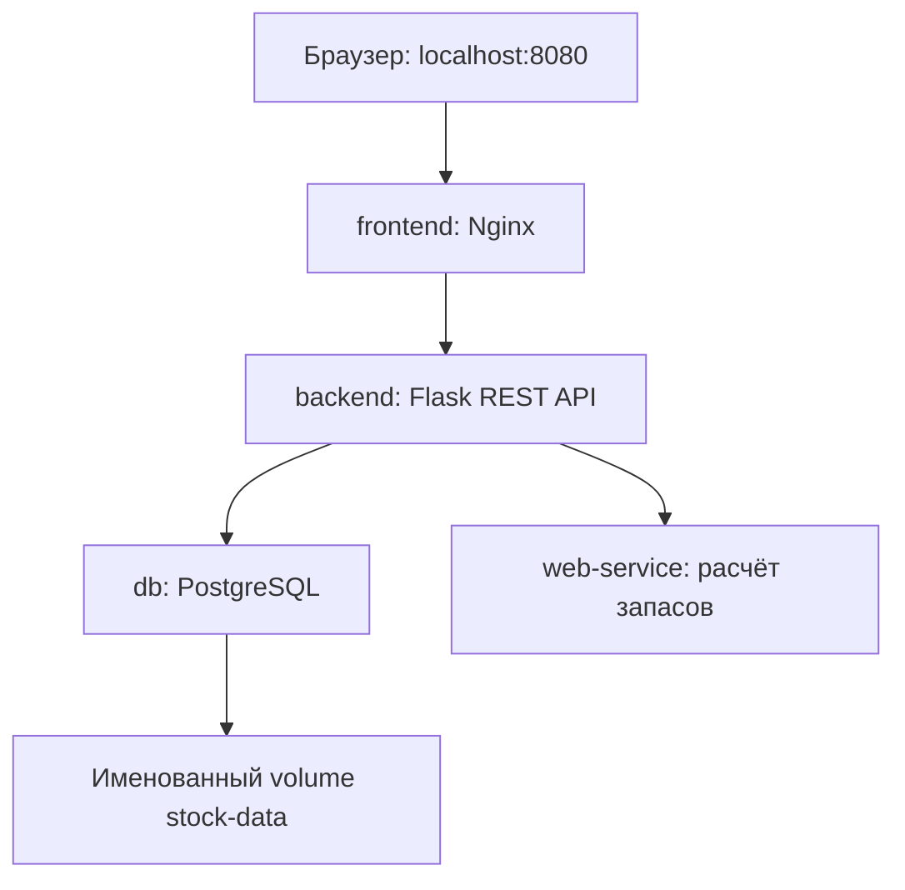

# Отчёт по лабораторной работе

**Дисциплина:** Проектирование веб-сервисов.  
**Тема работы:** Контейнеризация многокомпонентных приложений с помощью Docker Compose.  
**Выполнил:** Кулманаков Денис Сергеевич, группа 223-321.  
**Выбранная тема №55:** Учёт остатков на складе.  
**Проект:** Stock Watch.

## 1. Цель

Разработать многокомпонентное приложение, разделить его на четыре контейнера, настроить сетевое взаимодействие и автоматическую сборку через Docker Compose. Реализовать хранение данных в СУБД, автоматическую инициализацию и сохранение данных после пересоздания контейнеров.

## 2. Предметная область

Пользователь ведёт перечень товаров и задаёт текущий остаток, средний расход в день, срок доставки и страховой запас. Специализированный сервис рассчитывает порог пополнения и количество рекомендуемого заказа. Backend сохраняет снимки проверок для последующего просмотра истории.

Тема выбрана по просьбе автора проекта. В исходной методичке вариант определяется номером в журнале, однако в фактической таблице группы указаны выбранные темы, отличающиеся от номеров строк. До сдачи требуется подтвердить допустимость выбранной темы, если преподаватель требует строгое соответствие журналу.

## 3. Архитектура



| Компонент | Реализация | Ответственность |
| --- | --- | --- |
| Frontend | HTML/CSS/JavaScript, Nginx | Две основные кнопки, таблица товаров, форма CRUD, история |
| Backend | Python 3.12, Flask, psycopg, requests, Gunicorn | Проверка ввода, SQL-операции, HTTP-вызов сервиса, запись результата |
| Database | PostgreSQL 16 | Таблицы products и analyses, начальные данные |
| Web-service | Python 3.12, Flask, Gunicorn | Расчёт порогов, статусов и рекомендуемого заказа |

Сервисы используют одну стандартную мостовую сеть `lab-net`. На хост публикуется только порт frontend. Обращения к базе и вычислительному сервису осуществляются по именам `db` и `web-service`. Сложные сетевые компоненты, сертификаты и ingress не используются.

## 4. Алгоритм

Порог = ежедневный расход × срок доставки + страховой запас.

Если остаток ниже порога, статус критический. Если равен порогу, выдано предупреждение. Если выше, запас достаточен. Для критического состояния и предупреждения вычисляется заказ до целевого запаса: порог + семь дней расхода.

Контрольный пример: USB-C кабель, остаток 12, расход 5, доставка 3 дня, резерв 5. Порог: 5 × 3 + 5 = 20. Рекомендуемый заказ: 20 + 5 × 7 − 12 = 43. При изменении остатка на 80 статус становится достаточным, заказ — 0.

Модель учебная: расход и срок доставки постоянны; сезонность и реальные заказы не учитываются.

## 5. Данные и операции

Таблица `products`: `id`, `name`, `quantity`, `daily_usage`, `lead_days`, `safety_stock`. Идентификатор генерируется БД. Ограничения не допускают отрицательных остатков и нулевого расхода или срока доставки. Максимальное количество товаров в приложении — 1000.

Таблица `analyses`: `id`, `created_at`, `result`. JSONB сохраняет полный снимок входных значений и результатов. История остаётся корректной после изменения или удаления товара. Интерфейс показывает последние 20 проверок.

CRUD реализован через POST, GET, PUT и DELETE `/api/products`. Расчёт вызывается POST `/api/analysis`; история читается GET `/api/analyses`.

Backend использует параметризованные SQL-запросы и транзакции. При недоступности сервиса расчёта новая проверка не сохраняется. Пользователь получает сообщение об ошибке; чтение товаров не требует web-service.

## 6. Docker Compose

В корне проекта размещён `docker-compose.yml` с четырьмя сервисами: `frontend`, `backend`, `db`, `web-service`. Для frontend, backend и web-service написаны Dockerfile. PostgreSQL использует готовый образ.

Переменные окружения задают подключение к БД и URL сервиса. Значения по умолчанию обеспечивают учебный локальный запуск; `.env.example` описывает необязательные настройки. `.env` исключён из Git.

`depends_on` с `condition: service_healthy` обеспечивает готовность зависимостей при запуске. Для PostgreSQL используется `pg_isready`. Backend дополнительно проверяет наличие таблиц. Файл `db/init.sql` монтируется в каталог инициализации PostgreSQL только для чтения и создаёт три начальных товара при первой инициализации.

Именованный volume `stock-data` монтируется в `/var/lib/postgresql/data`. Обычная команда `docker compose down` сохраняет volume. Команда с `-v` удаляет его и данные.

## 7. Соответствие критериям

| Требование | Реализация | Проверка при сдаче |
| --- | --- | --- |
| Четыре контейнера | docker-compose.yml | up --build, затем ps |
| Минимум две кнопки | Загрузить склад / Проверить запасы | Показать оба результата |
| Работа Backend с СУБД | CRUD products, INSERT/SELECT analyses | Создать и изменить товар, показать psql |
| Отдельный web-service | POST /analyze, реальное вычисление | Изменить остаток и повторить проверку |
| Первичные данные | db/init.sql | На новой БД три товара |
| Сохранность | Именованный volume | down → up, сравнить товары и историю |
| Оформление | README, .gitignore, отчёт, Dockerfile | Открыть репозиторий |

## 8. Выполненная проверка и её границы

В среде подготовки выполнены **21 автоматический unit-тест**: границы порога, расчёт заказа, сводка и пустой склад, некорректные данные, ошибки JSON, отказ БД и вычислительного сервиса. Для проверок отказов зависимости backend подменены тестовыми объектами; это не проверка настоящего PostgreSQL.

Дополнительно проверены синтаксис Python и JavaScript, чтение Compose YAML, наличие четырёх сервисов, путей Dockerfile, bridge-сети, volume и зависимости от готовности БД.

**Docker Engine в среде подготовки отсутствовал. Сборка Docker-образов, выполнение init.sql в PostgreSQL и запуск всех четырёх контейнеров в этой среде не выполнялись.** Поэтому этот отчёт не утверждает, что они уже успешно запущены. Подготовлены скрипт `scripts/smoke.py` и GitHub Actions, которые проверяют реальные CRUD-операции, HTTP-расчёт и сохранность после перезапуска. Их результат нужно получить после запуска на компьютере автора или публикации на GitHub.

Перед сдачей выполнить:

```bash
docker compose config --quiet
docker compose up --build -d --wait
docker compose ps
python3 scripts/smoke.py
```

Затем выполнить сценарий сохранности данных из `DEFENSE.md`, записать фактический результат и при необходимости приложить скриншоты. Снимки не следует выдавать за выполненные до реального запуска.

## 9. Результат разработки

Подготовлены исходники всех компонентов, конфигурация контейнеризации, схема БД, интерфейс, автоматические проверки и инструкции запуска и защиты. Проект демонстрирует разделение ответственности между API, хранением и расчётом. Завершающие этапы сдачи — реальный запуск четырёх контейнеров, публичная публикация репозитория и внесение ссылки в таблицу группы.

## 10. Документация

- Docker Desktop for Mac: https://docs.docker.com/desktop/setup/install/mac-install/
- Установка Docker Compose: https://docs.docker.com/compose/install/
- Исходное задание: «Контейнеризация многокомпонентных приложений с помощью Docker Compose», предоставлено автором.
